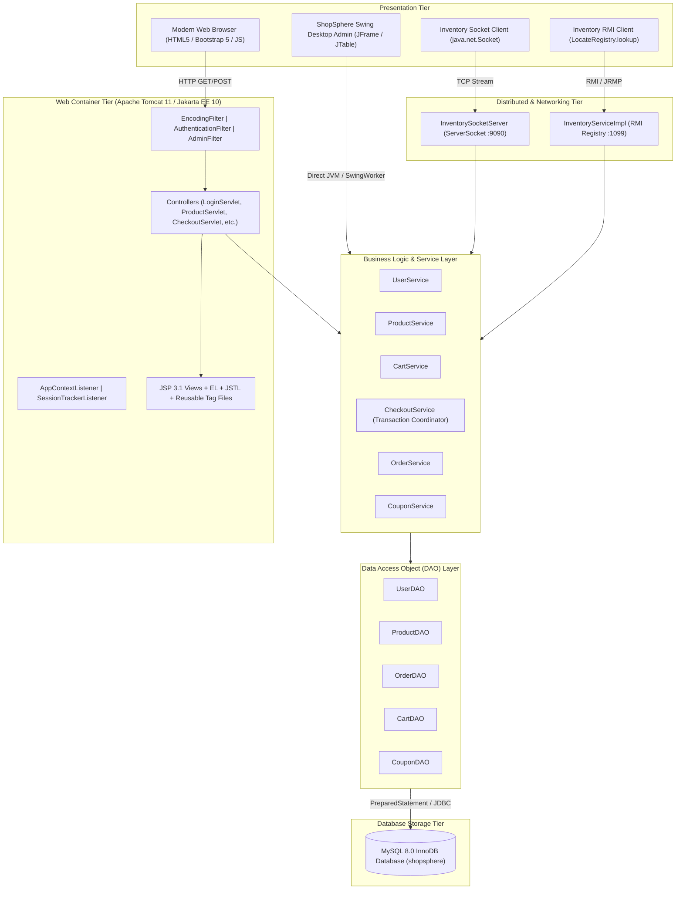
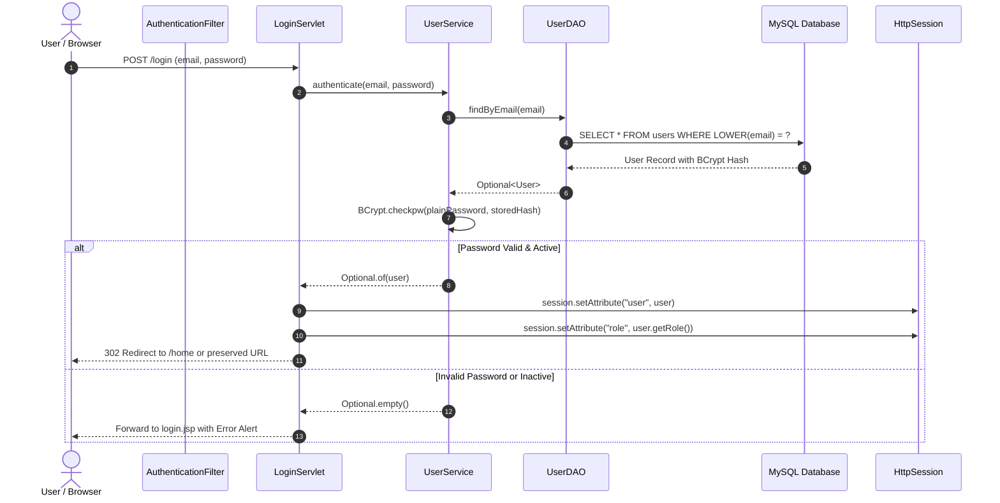
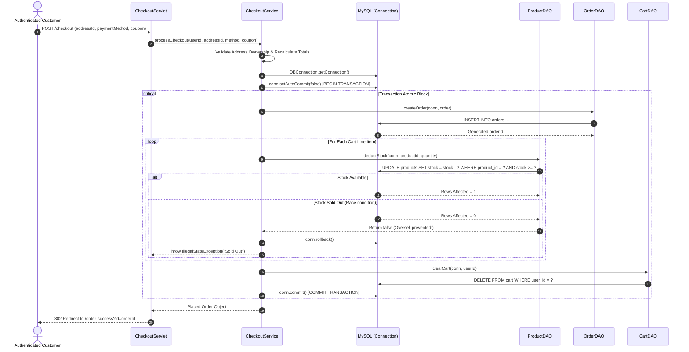

# ShopSphere — Architecture & System Design

## 1. Architectural Philosophy
ShopSphere is engineered as an enterprise-grade **N-Tier Distributed System** mapped directly to the **RTU Advanced Java** curriculum. It separates concerns strictly into presentation, request control, business domain logic, and persistence layers.

---

## 2. N-Tier Layered Architecture Diagram

---

## 3. Sequence Diagrams

### 3.1 Customer Authentication Sequence

### 3.2 Transactional Order Checkout & Inventory Deduction

---

## 4. Concurrency & Thread Safety
1. **Jakarta Servlets**: Servlets are multi-threaded singletons. All request-scoped variables are kept inside method local parameters or request attributes to eliminate race conditions.
2. **Java Swing Desktop (EDT)**: The Swing GUI Event Dispatch Thread is protected from freezing by offloading all database queries onto asynchronous `SwingWorker<T, V>` background threads.
3. **Socket Networking**: `InventorySocketServer` uses an `ExecutorService` cached thread pool so that multiple client TCP sockets communicate concurrently.
4. **Database Connections**: Connections are leased on demand via `DBConnection.getConnection()` and closed via try-with-resources. No static global `Connection` instances exist.
