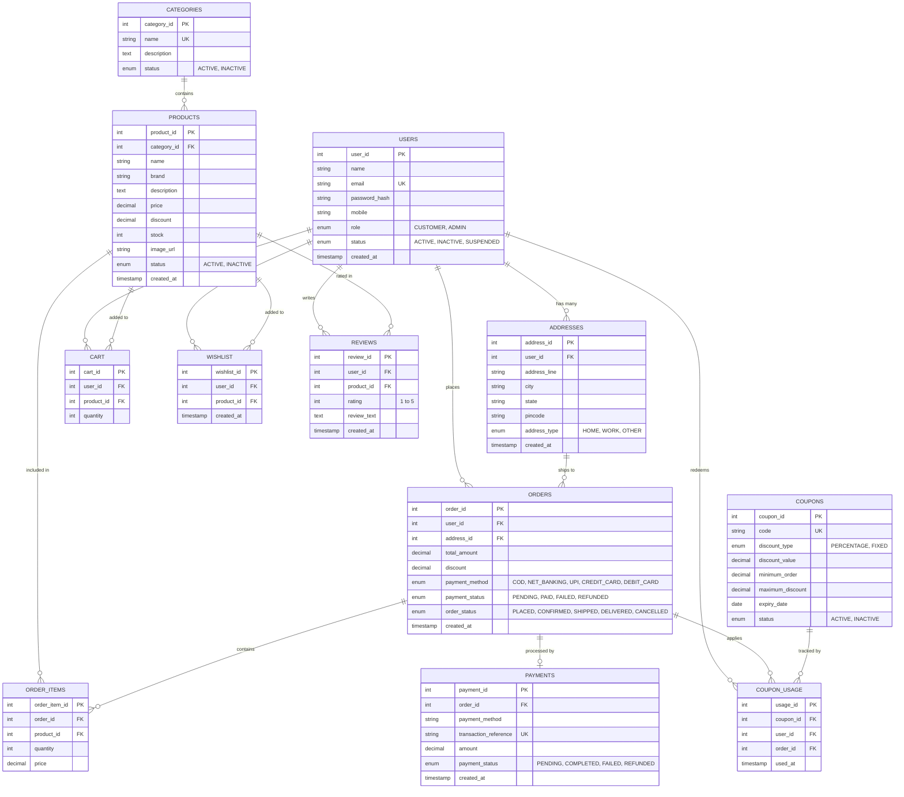

# ShopSphere — Database Architecture & Design Specification

## 1. Overview
The **ShopSphere** database is designed for **MySQL 8.0+** using the **InnoDB** storage engine to guarantee ACID transaction properties, foreign key integrity constraints, and row-level locking during concurrent inventory deductions.

---

## 2. Entity-Relationship (ER) Diagram (Mermaid)

---

## 3. Relational Table Specifications

### 3.1 `users`
| Column | Type | Constraints | Description |
|---|---|---|---|
| `user_id` | INT | PK, AUTO_INCREMENT | Unique user identifier |
| `name` | VARCHAR(100) | NOT NULL | Full customer/admin name |
| `email` | VARCHAR(150) | NOT NULL, UNIQUE | User login email (lowercased) |
| `password_hash` | VARCHAR(255) | NOT NULL | BCrypt hashed password ($2a$10$...) |
| `mobile` | VARCHAR(20) | NULL | Optional 10-digit phone number |
| `role` | ENUM | NOT NULL, DEFAULT 'CUSTOMER' | 'CUSTOMER', 'ADMIN' |
| `status` | ENUM | NOT NULL, DEFAULT 'ACTIVE' | 'ACTIVE', 'INACTIVE', 'SUSPENDED' |
| `created_at` | TIMESTAMP | DEFAULT CURRENT_TIMESTAMP | Registration timestamp |

### 3.2 `addresses`
| Column | Type | Constraints | Description |
|---|---|---|---|
| `address_id` | INT | PK, AUTO_INCREMENT | Unique address ID |
| `user_id` | INT | FK -> users(user_id) ON DELETE CASCADE | Associated customer ID |
| `address_line`| VARCHAR(255) | NOT NULL | Flat, building, street |
| `city` | VARCHAR(100) | NOT NULL | City |
| `state` | VARCHAR(100) | NOT NULL | State |
| `pincode` | VARCHAR(20) | NOT NULL | 6-digit postal code |
| `address_type`| ENUM | NOT NULL, DEFAULT 'HOME' | 'HOME', 'WORK', 'OTHER' |
| `created_at` | TIMESTAMP | DEFAULT CURRENT_TIMESTAMP | Record creation timestamp |

### 3.3 `categories`
| Column | Type | Constraints | Description |
|---|---|---|---|
| `category_id` | INT | PK, AUTO_INCREMENT | Category ID |
| `name` | VARCHAR(100) | NOT NULL, UNIQUE | Category title |
| `description` | TEXT | NULL | Details |
| `status` | ENUM | NOT NULL, DEFAULT 'ACTIVE' | 'ACTIVE', 'INACTIVE' |

### 3.4 `products`
| Column | Type | Constraints | Description |
|---|---|---|---|
| `product_id` | INT | PK, AUTO_INCREMENT | Unique product ID |
| `category_id` | INT | FK -> categories(category_id) ON DELETE RESTRICT | Category mapping |
| `name` | VARCHAR(200) | NOT NULL | Product title |
| `brand` | VARCHAR(100) | NOT NULL | Manufacturer brand |
| `description` | TEXT | NULL | Full description |
| `price` | DECIMAL(10,2)| NOT NULL, CHECK (price >= 0) | Base retail price |
| `discount` | DECIMAL(5,2) | NOT NULL, DEFAULT 0.00 | Percentage discount (0-100) |
| `stock` | INT | NOT NULL, DEFAULT 0, CHECK (stock >= 0) | Physical warehouse units |
| `image_url` | VARCHAR(500) | NULL | Relative asset path or URL |
| `status` | ENUM | NOT NULL, DEFAULT 'ACTIVE' | 'ACTIVE', 'INACTIVE' |
| `created_at` | TIMESTAMP | DEFAULT CURRENT_TIMESTAMP | Product entry timestamp |

### 3.5 `cart`
| Column | Type | Constraints | Description |
|---|---|---|---|
| `cart_id` | INT | PK, AUTO_INCREMENT | Item ID |
| `user_id` | INT | FK -> users(user_id) ON DELETE CASCADE | Owner |
| `product_id` | INT | FK -> products(product_id) ON DELETE CASCADE | Item reference |
| `quantity` | INT | NOT NULL, DEFAULT 1, CHECK (quantity > 0) | Selected units |
*Unique Constraint:* `UNIQUE (user_id, product_id)` prevents duplicate records.

### 3.6 `wishlist`
| Column | Type | Constraints | Description |
|---|---|---|---|
| `wishlist_id`| INT | PK, AUTO_INCREMENT | Wishlist entry ID |
| `user_id` | INT | FK -> users(user_id) ON DELETE CASCADE | User reference |
| `product_id` | INT | FK -> products(product_id) ON DELETE CASCADE | Product reference |
| `created_at` | TIMESTAMP | DEFAULT CURRENT_TIMESTAMP | Timestamp |
*Unique Constraint:* `UNIQUE (user_id, product_id)` prevents duplicate wishlist entries.

### 3.7 `orders`
| Column | Type | Constraints | Description |
|---|---|---|---|
| `order_id` | INT | PK, AUTO_INCREMENT | Order tracking ID |
| `user_id` | INT | FK -> users(user_id) ON DELETE RESTRICT | Customer |
| `address_id` | INT | FK -> addresses(address_id) ON DELETE SET NULL | Shipping location |
| `total_amount`| DECIMAL(10,2)| NOT NULL, CHECK (total_amount >= 0) | Gross item total |
| `discount` | DECIMAL(10,2)| NOT NULL, DEFAULT 0.00 | Applied coupon discount |
| `payment_method`| ENUM | NOT NULL | COD, NET_BANKING, UPI, CREDIT_CARD, DEBIT_CARD |
| `payment_status`| ENUM | NOT NULL, DEFAULT 'PENDING' | PENDING, PAID, FAILED, REFUNDED |
| `order_status` | ENUM | NOT NULL, DEFAULT 'PLACED' | PLACED, CONFIRMED, SHIPPED, DELIVERED, CANCELLED |
| `created_at` | TIMESTAMP | DEFAULT CURRENT_TIMESTAMP | Order placement timestamp |

### 3.8 `order_items`
| Column | Type | Constraints | Description |
|---|---|---|---|
| `order_item_id` | INT | PK, AUTO_INCREMENT | Line item ID |
| `order_id` | INT | FK -> orders(order_id) ON DELETE CASCADE | Parent order |
| `product_id` | INT | FK -> products(product_id) ON DELETE RESTRICT | Product snapshot |
| `quantity` | INT | NOT NULL, CHECK (quantity > 0) | Purchased quantity |
| `price` | DECIMAL(10,2)| NOT NULL, CHECK (price >= 0) | Price at time of order |

### 3.9 `payments`
| Column | Type | Constraints | Description |
|---|---|---|---|
| `payment_id` | INT | PK, AUTO_INCREMENT | Transaction row ID |
| `order_id` | INT | FK -> orders(order_id) ON DELETE CASCADE | Order link |
| `payment_method` | VARCHAR(50)| NOT NULL | Payment provider |
| `transaction_reference` | VARCHAR(100)| NOT NULL, UNIQUE | Unique audit string |
| `amount` | DECIMAL(10,2)| NOT NULL | Transacted sum |
| `payment_status` | ENUM | NOT NULL | PENDING, COMPLETED, FAILED, REFUNDED |
| `created_at` | TIMESTAMP | DEFAULT CURRENT_TIMESTAMP | Audit timestamp |

### 3.10 `coupons` & `coupon_usage`
Tracks discount rules, minimum cart amounts, maximum caps, expiry dates, and individual customer redemptions to prevent multiple coupon uses.
